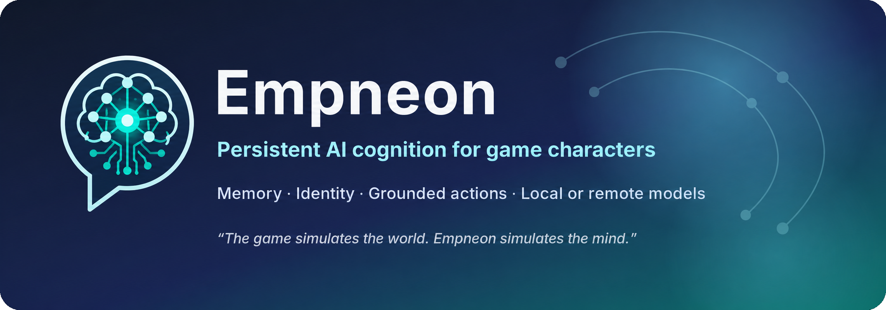
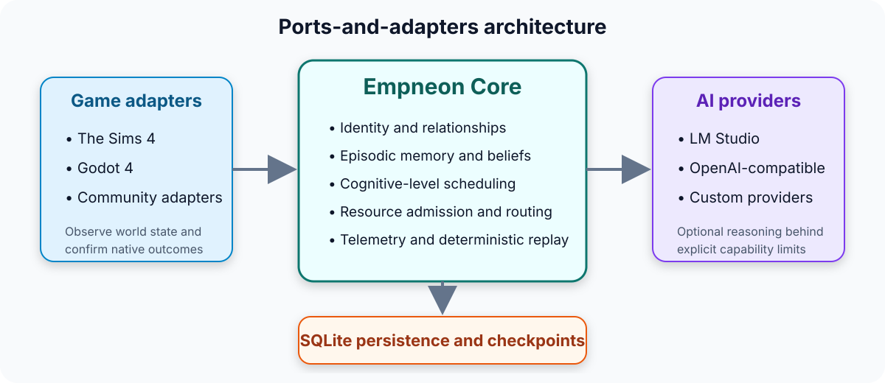

<p align="center">
  
</p>

<p align="center">
  <a href="LICENSE"></a>
  
  
  
  
</p>

<p align="center">
  <strong>The game simulates the world. Empneon simulates the mind.</strong>
</p>

Empneon is an open-source cognitive runtime for persistent, state-aware game characters. It keeps identity, relationships, memories, beliefs, and confirmed outcomes as structured data, then uses deterministic rules or optional language models to decide what a character should say or attempt next.

The project currently includes a functional **The Sims 4 reference adapter** and a smaller **Godot 4 portability adapter**.

> [!IMPORTANT]
> Empneon is an experimental alpha. It is suitable for development, demonstrations, and controlled community testing—not for production use or unattended deployment.

## Why Empneon?

Most LLM-driven characters generate text from a prompt and immediately treat that text as reality. Empneon separates **proposals** from **confirmed world state**:

```text
Character context + confirmed memories
              │
              ▼
   Deterministic rule or AI model
              │
              ▼
      Dialogue / proposed action
              │
              ▼
        Game attempts action
              │
              ▼
   Adapter reports actual outcome
              │
              ▼
 Only confirmed facts become memory
```

This is intended to reduce a common failure mode in AI characters: invented dialogue becoming false history.

## What it provides

| Capability | Current implementation |
|---|---|
| Persistent identity | Structured profiles, goals, emotions, voice, and relationships |
| Episodic memory | Confirmed events, observations, beliefs, provenance, and recall |
| Grounded actions | Models propose actions; adapters confirm what actually happened |
| Cognitive levels | Deterministic behavior through bounded interactive reasoning |
| Provider independence | LM Studio, OpenAI-compatible endpoints, and custom providers |
| Resource controls | Declared RAM, VRAM, concurrency, token, and latency admission |
| Replay and diagnostics | Timeline, telemetry, regression scenarios, and deterministic replay |
| Multiple games | The Sims 4 reference adapter and Godot portability proof |

## Choose your path

### I want to test the Sims 4 adapter

Start with the [Sims 4 setup and privacy guide](adapters/thesims4/docs/setup.md).

The adapter currently supports:

- Player-triggered contextual dialogue
- Persistent identity and relationships
- Pair-scoped memory recall
- Grounded action proposals and game-confirmed results
- Local LM Studio models
- OpenAI-compatible providers
- Save-aware database checkpoints
- Provider-free deterministic autonomy at lower cognitive levels

Before testing:

- Back up the affected Sims save.
- Confirm that your game patch is supported by the release notes.
- Expect configuration and compatibility issues during alpha testing.
- Do not report normal mod breakage after a game update as data corruption until compatibility has been checked.

### I want to integrate another game

Read:

- [Adapter development](core/docs/adapter-development.md)
- [Core API and compatibility](core/docs/api.md)
- [Project vision](core/docs/vision.md)

A game integration implements two structural Python protocols:

```python
class GameAdapter(Protocol):
    def observe(self) -> tuple[WorldEvent, ...]: ...
    def execute(self, decision: Decision, /) -> ActionResult: ...


class LLMProvider(Protocol):
    @property
    def capabilities(self) -> ModelCapabilities: ...

    async def generate(
        self,
        request: GenerationRequest,
    ) -> GenerationResult: ...

    async def health_check(self) -> bool: ...
```

The adapter translates game-specific state and reports native outcomes. Empneon Core owns provider selection, persistent memory, scheduling, resource admission, telemetry, and replay.

## Architecture

<p align="center">
  
</p>

```text
Games and simulations
├── The Sims 4 reference adapter
├── Godot 4 portability adapter
└── Community adapters
             │
             ▼
        Empneon Core
├── contracts and state transitions
├── identity, relationships, memories, and beliefs
├── cognitive-level scheduling and deterministic fallbacks
├── provider configuration and capability routing
├── resource admission, telemetry, and replay
└── SQLite persistence and save-aware checkpoints
             │
             ▼
Optional AI providers
├── LM Studio
├── OpenAI-compatible endpoints
└── custom LLMProvider implementations
```

SQLite is currently the only database backend. The Godot adapter is a portability proof. The Sims 4 integration is a reference adapter, not a replacement for the game’s complete autonomy system.

## Cognitive Level of Detail

Empneon assigns work to a bounded cognitive level rather than sending every decision to the largest available model.

| Level | Mechanism | Example |
|---|---|---|
| CLOD 0 | Persistent state and history | Identity, memories, observations |
| CLOD 1 | Deterministic rules | Routine autonomous behavior |
| CLOD 2 | Small model or bounded heuristic | Memory selection or classification |
| CLOD 3 | Interactive reasoning | Player conversation or planning |
| CLOD 4 | Rare consequential reasoning | High-impact, infrequent decisions |

`ResourceGovernor` admits declared RAM, VRAM, concurrency, token, and latency estimates. `select_cognition` chooses an affordable route and falls back to deterministic CLOD 1 when no route fits or provider execution fails.

The current Sims adapter does **not** continuously measure live CPU, RAM, VRAM, or frame time. Resource admission is based on declared estimates rather than complete hardware monitoring.

## Memory and grounding

The versioned SQLite schema stores:

- Character identity and goals
- Relationships and emotional state
- Canonical events and observations
- Beliefs with provenance and revision history
- Episodic memories and adapter-specific documents
- Provider usage and latency
- Action proposals, confirmed results, and ordered consequences

The Sims 4 bridge uses pair-scoped recall. A Sim should not retrieve another pair’s private information merely because the information exists elsewhere in the database.

The recall pipeline is bounded:

```text
Confirmed pair-scoped candidates
             │
             ▼
Deterministic filtering and ranking
             │
             ▼
Optional small-model memory selection
             │
             ▼
Deterministic validation and fallback
             │
             ▼
Only selected evidence enters dialogue generation
```

For factual recall, attributed facts take precedence over accumulated factless answers. The Sims
adapter validates time and location details, preference direction, complete promises, relation
ownership, and concrete identifiers before accepting model dialogue; unsupported replies retry or
fall back to attributed evidence without applying relationship effects.

## Repository layout

```text
Empneon/
├── core/                  Runtime, contracts, providers, persistence, and tests
├── adapters/
│   ├── thesims4/          Script mod, local backend, configuration, and evidence
│   └── godot/             Localhost bridge and minimal Godot project
├── tests/                 Shared adapter-contract tests
├── docs/                  Roadmap, plans, and project documentation
└── .github/workflows/     CI and release automation
```

Each Python project remains independently buildable and releasable from its directory.

## Development setup

Empneon requires Python 3.11 or newer.

From the monorepo root:

```powershell
py -3.12 -m pip install -e "core[dev]" -e "adapters/thesims4[dev]" -e "adapters/godot[dev]"
```

Run the main CI checks:

```powershell
ruff check core/src core/tests adapters/thesims4/src adapters/thesims4/tests adapters/godot/src adapters/godot/tests tests
mypy core/src adapters/thesims4/src adapters/godot/src
pytest core
pytest adapters/thesims4
pytest adapters/godot
pytest tests
empneon-regress core/scenarios/clod1-regressions.json
```

## Providers

Included provider implementations:

- **`LMStudioProvider`** — discovers a loaded local model and supports LM Studio’s native and OpenAI-compatible APIs.
- **`OpenAICompatibleProvider`** — supports compatible services such as OpenRouter, Ollama, llama.cpp servers, and other endpoints implementing the expected API shape.
- **Custom providers** — implement the `LLMProvider` protocol.

The Sims 4 configuration includes an OpenRouter-compatible entry. Select it with `AI_SIM_PROVIDER=openrouter`, configure the model through `AI_SIM_MODEL`, and provide credentials through `AI_SIM_API_KEY`.

> [!CAUTION]
> Never commit API keys, `.env` files, private conversation databases, save data, or diagnostic bundles containing unredacted user content.

## Hardware baseline

The primary local validation machine is:

- Ryzen 7 4800H
- RTX 2060 Laptop GPU with 6 GB VRAM
- 16 GB RAM
- The Sims 4 running concurrently

The reference adapter defaults to one concurrent agent request. Existing measurements show significant pressure during repeated local-model calls; they do not establish broad performance or scalability.

See:

- [Benchmark results](adapters/thesims4/docs/benchmark-results.md)
- [Artifact manifest](adapters/thesims4/output/README.md)

## Current validation

Implemented and tested behavior includes:

- Core contracts exercised through two materially different adapters
- Game-confirmed action persistence
- Cancelable single-turn Sims conversations
- Bounded waiting and routing phases
- Save/reload persistence
- Pair-scoped confirmed-memory selection
- Deterministic recall fallback
- Category-aligned Sims dialogue safety for friendly, funny, romance, mean, and mischief
- Privacy-bounded rejection diagnostics containing reasons but no prompts or raw provider replies
- Belief provenance, contradiction, revision, and trust-decayed propagation
- Provider-free CLOD 1 telemetry
- Provider-backed CLOD 3 usage and latency accounting
- Timeline, replay, regression fixtures, and package builds
- Stable repeated Sims identity import

Detailed evidence is maintained in the repository documentation and test suites. These results do **not** establish novelty, broad player value, general hardware compatibility, or production scalability.

## Project status and roadmap

Empneon is being developed as:

1. An experimental open-source Sims 4 mod
2. A reusable cognition runtime for game characters
3. A technical reference for persistent memory, grounded actions, and provider-independent AI integration

Current priorities:

- Simplify Sims 4 installation and diagnostics
- Validate the experience with external testers
- Decompose large Sims adapter modules
- Improve typed application boundaries
- Document third-party adapter development
- Publish gameplay demonstrations and reproducible examples

See the [open-source roadmap](docs/roadmap.md).

## Releases

GitHub Releases use synchronized versions and component-specific tags:

- `core-vX.Y.Z`
- `thesims4-vX.Y.Z`
- `godot-vX.Y.Z`

Core releases contain a wheel and source distribution. Adapter archives include the adapter wheel and matching Core wheel. Releases include `SHA256SUMS.txt`.

Install a downloaded Core wheel with:

```bash
python -m pip install ./empneon-X.Y.Z-py3-none-any.whl
```

Verify release checksums:

```bash
sha256sum -c SHA256SUMS.txt
```

On Windows PowerShell:

```powershell
Get-FileHash -Algorithm SHA256 .\empneon-X.Y.Z-py3-none-any.whl
```

## Documentation

- [Project vision](core/docs/vision.md)
- [API and compatibility](core/docs/api.md)
- [Adapter development](core/docs/adapter-development.md)
- [Research hypotheses and evidence](core/docs/innovations.md)
- [Open-source roadmap](docs/roadmap.md)
- [The Sims 4 setup and privacy](adapters/thesims4/docs/setup.md)
- [In-game Core feature test plan](adapters/thesims4/docs/in-game-core-feature-test-plan.md)
- [In-game Core feature test results](adapters/thesims4/docs/in-game-core-feature-test-results.md)

## Responsible use and affiliation

Empneon is an independent open-source project. It is not affiliated with, endorsed by, or sponsored by Electronic Arts or Maxis.

Users and contributors are responsible for complying with game terms, provider terms, applicable laws, and the policies of communities where Empneon is distributed.

## License

Licensed under the [Apache License 2.0](LICENSE).
